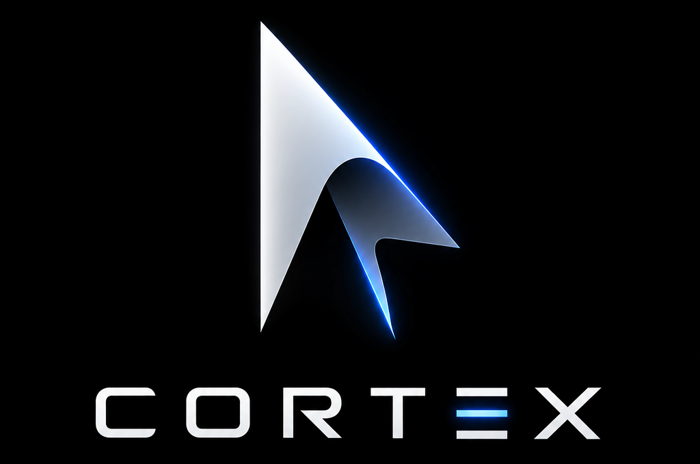

<h1 align="center">Cortex</h1>

<p align="center"></p>

<p align="center">A closed-loop computer-use MCP server for Windows — agents observe the screen, propose actions, and Cortex proves that each action did what it was supposed to do.</p>

<p align="center">
  <a href="LICENSE"></a>
  
  
</p>

## What is Cortex

Cortex (current release: 0.7.6) is a Model Context Protocol (MCP) server that
gives AI agents a safe, verifiable way to operate a Windows desktop. An agent
connects over stdio and gets a guarded, ten-tool surface: open a session,
capture the screen (full, aliased, or zoomed to a region), execute actions
(click, type, hotkeys, drags, window focus, app attach-or-launch, waypoint
plans), wait with explicit completion, re-serve captured frames, and stop
everything at any moment.

Between a proposed action and the physical input, Cortex runs a fixed pipeline:
ground the action against a fresh observation, validate it (staleness,
allowlists, coordinate integrity), classify its risk, request approval when
policy requires it, and only then execute through a stop-checked backend. After
execution it re-observes and verifies **semantically** — did the intended state
transition actually occur? — and every reply carries a closed `result` token
with `ok = (result ∈ {verified, marker})`. `uncertain` is never success. The
driving agent reads the outcome and decides; the server never retries blindly,
and nothing on screen and nothing a model says can grant authority.

Every session writes a redacted JSONL audit trail, is capped by hard resource
limits, and is reaped automatically if the agent forgets it (idle sessions are
stopped through the same kill path as `stop_session`).

Requirements: Windows 10/11/Server with an interactive display session (no
headless mode), Python 3.11+, no vision API key — the deterministic surface
never calls a model. History: [VERSIONS.md](VERSIONS.md) (release ledger);
[docs/history/](docs/history/) (removed machinery, red-team logs).

## Install and update

**[docs/INSTALL.md](docs/INSTALL.md)** (manual install, the `cortex-mcp` CLI,
agent install prompts). Two routes: `pip install git+…` installs
the package only (hand registration — the CLI lifecycle does not manage it);
`cortex-mcp install`/`update` manage a git CLONE with an editable install
(`update` fast-forwards `origin/main`). From a clone:

```bash
git clone https://github.com/Xenos-ink/Cortex.git && cd Cortex
python -m pip install -e .
python -m computer_use_mcp.cli install                    # provision + register into agent configs + probe
python -m computer_use_mcp.cli update                     # fast-forward + refresh + re-probe (ff-only, never resets)
python -m computer_use_mcp.cli probe                      # verify the served surface (exit 0 on PASS)
```

`install`/`update` back up every config file before writing and never overwrite
an existing cortex entry without `--force` (the canonical
`%LOCALAPPDATA%\Cortex` agent-driven route is in docs/INSTALL.md).

## Quick start

Register the server in your MCP client (paths adjusted to your machine), then
drive it:

```json
{"mcpServers": {"cortex": {"command": "C:\\path\\to\\.venv\\Scripts\\python.exe",
 "args": ["-m", "computer_use_mcp.server"], "cwd": "C:\\path\\to\\Cortex"}}}
```

1. `start_session` — get a `session_id` (a non-vision host model must pass
   `image_delivery="text"`).
2. `computer_observe` — look at the screen; `computer_execute` — act, stating
   `expected_effect` whenever you can; read the `result` token and the
   `verification` evidence in the reply.
3. Repeat until the task is done on `verified` outcomes, then `stop_session`.
   Resuming from a checkpoint file is available via
   `start_session(resume_from_checkpoint=…)` (reply keys `resumed` /
   `continuation_of` / `resumed_from_checkpoint`; honest scope in docs/TOOLS.md).

## The ten tools at a glance

| Tool | For |
|---|---|
| `start_session` | open a guarded session; returns `session_id` and the effective `limits` |
| `stop_session` | arm the kill path and end the session (idempotent) |
| `computer_observe` | fresh full-screen capture + grounding metadata |
| `computer_screenshot` | compatibility alias of `computer_observe` |
| `computer_zoom` | fresh capture cropped to a region (observation-only) |
| `computer_execute` | act: the 13-action vocabulary, `follow_ups` batches, waypoint `plan` handshake |
| `computer_wait` | blocking wait, up to one segment per call, with a `wait_id` |
| `computer_wait_status` | block for the next wait segment, or peek with `block=false` |
| `computer_cancel_wait` | end a wait early; reports elapsed/remaining |
| `computer_fetch_image` | re-serve a frame a reply carried, by `image_id` |

`computer_execute` dispatches exactly 13 actions — `click`, `double_click`,
`right_click`, `drag`, `type`, `keypress`, `hotkey`, `scroll`, `wait`, `done`,
`move`, `focus_window`, `ensure_app` (no `key`, no `triple_click`). Parameters
and bounds: **[docs/TOOLS.md](docs/TOOLS.md)**.

## The unified reply contract (in brief)

One envelope holds for every tool reply, every `follow_up_results[i]` item,
every plan step, the terminal plan, and the wait/cancel/fetch replies:

- `result` is a closed token: `verified`, `marker`, `uncertain`, `failed`,
  `rejected`, `not_executed`, `dry_run`, `stopped`, `unknown` — and
  `ok` is True iff the token is `verified` or `marker`. A dry-run, a rejection,
  an approval gate, and an uncertain action are all `ok:false`.
- Dispatched actions carry a `verification` block (`outcome`, `confidence`,
  `evidence`, `verification_method`) and three separate confidences
  (model / grounding / verification) — none is a success probability.
- Plan replies always carry `failure_reason` (a closed vocabulary),
  `not_executed`, and `evidence_by_backend`; the terminal plan's `ok` is True
  only for `result:"verified"`. Every image-bearing reply discloses
  `image_outbound_scale`. Rejections name their gate in `reasons` and dispatch
  nothing (except a mid-type focus drift, which reports `partial_delivery`).

Full reference: **[docs/REPLY-CONTRACT.md](docs/REPLY-CONTRACT.md)**.

## The cortex-skill (fast-path driving)

`cortex-skill` is a small agent skill that teaches any LLM/VLM driving Cortex
to spend fewer turns: the operating loop, the ten-tool table, reply reading,
decision policy, efficiency defaults, and escalation — with the detailed
protocol in `references/` (plan protocol, reply contract, glossary, worked
examples). It changes nothing in the server; it shapes how the driving host
reacts to results. Truth-checked against the code by `tests/test_skill_truth.py`.

```bash
npx --yes github:Xenos-ink/Cortex install   # install into every detected user-scope skills dir
npx --yes github:Xenos-ink/Cortex update    # refresh only already-installed dirs (backs each up first)
```

`install` never overwrites (a differing install reports `SKIPPED-EXISTS`; run
`update`); `update` is the only overwrite path and backs each dir up first. The
skill lives at `skills/cortex-skill/SKILL.md`; the installer is
`skills/install-cortex-skill.mjs` (stdlib-only Node, no telemetry, no network).

## Safety model (summary)

- **Threat model:** the model is a fallible proposer, never an authority;
  screen content is untrusted data; the vision provider is outside the trust
  boundary and receives redacted payloads.
- **Risk engine:** every action is classified LOW / MEDIUM / HIGH / CRITICAL.
  HIGH always requires approval; CRITICAL is blocked (no MCP tool can authorize
  it today); unknown context escalates fail-closed.
- **Fail-closed everywhere:** unverifiable coordinate spaces refuse input;
  staleness refuses the action (one automatic re-observe first); `uncertain`
  is reported honestly; every refusal names its gate; secret redaction is
  enforced at the audit sink, provider payloads, checkpoints, and the
  tool-response path.
- **Kill path + idle reaper:** a thread-safe stop token is checked before every
  physical input; `stop_session` (or 15 minutes of inactivity, configurable)
  stops the session through one audited funnel; later calls get
  `session_stopped`. Nothing a model outputs can reach the stop setter.
- **Launch truth:** `ensure_app` may spawn a target server-side under the
  default `launch="server"` policy — with NO process allowlist configured any
  resolvable target may launch, and with one configured only allowlisted
  targets may; `CORTEX_ATTACH_OR_LAUNCH=driver` restores never-launch. Launches
  are never silent (typed outcome, `LAUNCHED` prefix on a real spawn).

Full model, risk taxonomy, and the honest residual-risk list: **[docs/SAFETY.md](docs/SAFETY.md)**.

## Configuration

Limits (live vs reserved, defaults, bands) and every environment variable the
code reads, with defaults and accepted bands:
**[docs/CONFIGURATION.md](docs/CONFIGURATION.md)**. Highlights:
`CORTEX_IMAGE_DELIVERY=text` for non-vision host models (or
`start_session(image_delivery="text")` per session);
`CORTEX_SESSION_IDLE_TIMEOUT_SECONDS` (default 900 s, `0` disables);
`CORTEX_WAIT_SEGMENT_SECONDS` (default 45 s per segment);
`CORTEX_RESULT_IMAGE_MAX_KB` (default 180 KB outbound).

## Limitations (honest)

- Windows-first; non-Windows machines can import the package and run the test
  suite against in-memory fakes but cannot drive a real desktop. No OS-level
  sandboxing: policy, approval, and cancellation are enforced in-process, and
  the kill switch is cooperative — the failsafe screen corner is the only
  physical backstop.
- Text-level verification needs text data: the OCR `text_predicate` tier is
  opt-in and inert without OCR regions; the UIA semantic read covers control
  text where the OS exposes it, degrading silently to `None` otherwise.
- Multi-monitor logic is unit-tested with fake monitor sets; the live-desktop
  e2e reference box is single-monitor. Model-based verification is only as
  good as the configured provider; deterministic strategies always run first.
- Risk classification is pattern + context matching (English plus a small
  Arabic set), not semantic understanding. Screenshot secret redaction is
  text-pattern and explicit-region blur only; secrets visible purely as
  pixels are not detected.

The full residual list, each with its compensating controls:
[docs/SAFETY.md](docs/SAFETY.md) §Known residual risks.

## Testing and benchmarks

```bash
python -m pytest tests/ -q           # offline suite (live-desktop e2e auto-skips)
python -m ruff check src tests benchmarks
# real-Windows e2e — drives live apps; opt in explicitly, never in CI:
# PowerShell:  $env:CUMCP_RUN_E2E = "1"; python -m pytest tests/e2e/ -q
```

The e2e gate opens only for the exact `CUMCP_RUN_E2E=1`, and every e2e app
instance is isolated by a run-unique window token, so the suite can never
attach to a window it did not launch. Suite status per release:
[VERSIONS.md](VERSIONS.md).

`benchmarks/` contains measurement scaffolding only (task YAMLs, a runner with
fake/env modes, and `benchmarks/tasks_hard/DRIVER-PROTOCOL.md`, the driver
doctrine the tool-surface events are specified against). **No scores are
published**; every harness artifact carries
"Harness validation output — NOT benchmark scores."

## Documentation

| Document | Contents |
|---|---|
| [docs/INSTALL.md](docs/INSTALL.md) | install, update, the `cortex-mcp` CLI, agent install prompts |
| [docs/TOOLS.md](docs/TOOLS.md) | the ten tools: parameters, bounds, semantics |
| [docs/REPLY-CONTRACT.md](docs/REPLY-CONTRACT.md) | the unified reply contract, token sets, error codes |
| [docs/CONFIGURATION.md](docs/CONFIGURATION.md) | limits (live/reserved) and every env var |
| [docs/ARCHITECTURE.md](docs/ARCHITECTURE.md) | the layered package, pipeline, pinned contracts |
| [docs/SAFETY.md](docs/SAFETY.md) | the safety model and residual risks |
| [docs/history/](docs/history/) | removed machinery and red-team logs (labelled historical) |

Release ledger and planned work: [VERSIONS.md](VERSIONS.md), [ROADMAP.md](ROADMAP.md).

## Credits and references

Research that informed the design (no code redistributed):

- OpenAI — [Computer-Using Agent](https://openai.com/index/computer-using-agent/); [Operator system card](https://openai.com/index/operator-system-card/)
- OSWorld ([arXiv:2404.07972](https://arxiv.org/abs/2404.07972)); OSWorld 2.0 ([arXiv:2606.29537](https://arxiv.org/abs/2606.29537)); ScreenSpot-Pro ([arXiv:2504.07981](https://arxiv.org/abs/2504.07981))
- Agent S2 ([arXiv:2504.00906](https://arxiv.org/abs/2504.00906)); Agent S ([arXiv:2410.08164](https://arxiv.org/abs/2410.08164)); UI-TARS ([arXiv:2501.12326](https://arxiv.org/abs/2501.12326)); SeeClick ([arXiv:2401.10946](https://arxiv.org/abs/2401.10946)); CogAgent ([arXiv:2312.08914](https://arxiv.org/abs/2312.08914))

Built on: [MCP Python SDK](https://github.com/modelcontextprotocol/python-sdk),
[pydantic](https://docs.pydantic.dev/), [Pillow](https://python-pillow.org/),
[mss](https://github.com/BoboTiG/python-mss),
[PyAutoGUI](https://pyautogui.readthedocs.io/),
[httpx](https://www.python-httpx.org/).

## License

MIT — see [LICENSE](LICENSE). Copyright (c) 2026 Xenos-ink.
